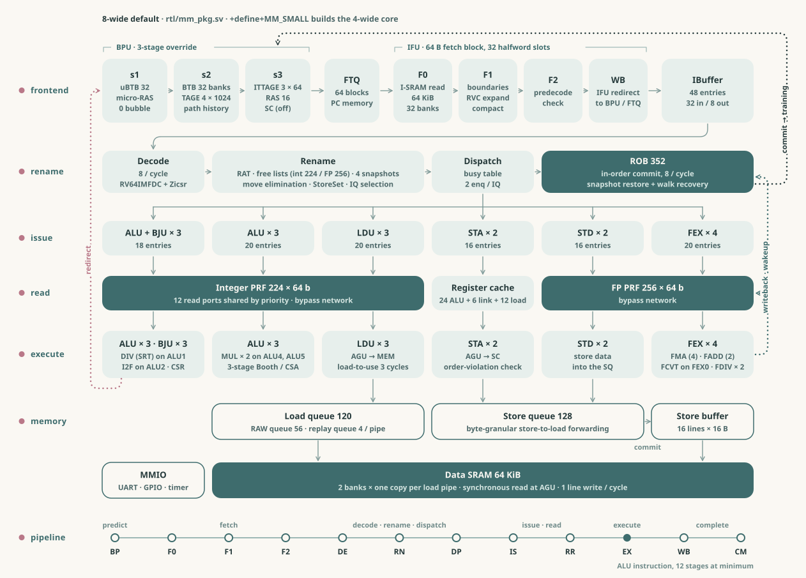

<div align="center">

<picture>
  <source media="(prefers-color-scheme: dark)" srcset="docs/logo-dark.png">
  
</picture>

**An 8-wide out-of-order RV64IMFDC_Zicsr core in SystemVerilog**


-B97888)


[Overview](#overview) • [Getting started](#getting-started) • [Performance](#performance) •
[Microarchitecture](#microarchitecture) • [Verification](#verification) • [FPGA](#fpga)

</div>

## Overview

meimei is a superscalar out-of-order RISC-V core for bare-metal programs. It renames registers into
per-class physical register files, fetches through a decoupled frontend with a 3-stage branch
predictor, and runs loads speculatively with store-to-load forwarding and memory dependence
prediction. The goal is to run relatively small programs, ones that fit entirely in cache, as fast
as possible. The core is checked commit by commit against an instruction-set simulator and runs
CoreMark and Embench-IoT on an Alveo V80 FPGA card.

- **ISA**: RV64I + M + F + D + C + Zicsr. IEEE 754 single / double precision with all rounding modes,
  subnormals, NaN-boxing and exception flags. No privileged modes, MMU, A or Zifencei.
- **Two configurations** from one source: 8-wide (default) and 4-wide (`+define+MM_SMALL`).
- **Every feature behind a switch**: sizes and feature flags are `localparam`s in
  [`rtl/mm_pkg.sv`](rtl/mm_pkg.sv), so each idea can be turned off and compared cycle for cycle.
- **Verified differentially**: random programs in seven modes, C tests against host-compiled golden
  output, and per-cycle simulation-only self-checks of the pipelined units.



## Getting started

### Prerequisites

- [Verilator](https://verilator.org) 5.x and Python 3
- A RISC-V GCC with newlib built for `--with-arch=rv64imfdc_zicsr --with-abi=lp64d --with-cmodel=medany`
  (the Makefiles expect `$HOME/opt/riscv64/bin/riscv64-unknown-elf-gcc`)
- Optional: Vivado 2024.2 for the FPGA flows, [Unicorn](https://www.unicorn-engine.org) for the ISS cross-checks

### Run a program on the SoC

```sh
make -C sim build CONFIG=small                # Verilator model of the 4-wide core
make -C sim run PROG=../software/hello        # prints over the simulated UART
make -C sim test CONFIG=small                 # C tests: UART output == host golden output
make -C sim coremark CONFIG=full              # 8-wide CoreMark
make -C sim check PROG=../software/coremark   # lockstep comparison with the ISS
```

> [!NOTE]
> Building the 8-wide model (`CONFIG=full`) takes about 20 minutes; it simulates at about
> 1k cycles/s, the 4-wide one at about 6k cycles/s.

### Run the random-program regression

```sh
tb/run.sh 100                          # build + 100 random programs (seeds 1..100)
MODE=loop CYC=12000 tb/prun.sh 300     # parallel run of one mode
VFLAGS=+define+MM_SMALL REBUILD=1 tb/run.sh 50   # 4-wide configuration
```

Modes are `rand`, `loop`, `fp`, `fpcsr`, `fploop`, `rvc`, and `+c` on any of them (e.g. `loop+c`)
to re-lay the program out with compressed instructions. Use `REBUILD=1` after changing the RTL.

## Configuration

| | 8-wide (default) | 4-wide (`MM_SMALL`) |
|---|---|---|
| fetch block / FTQ / IBuffer | 64 B (32 halfword slots) / 64 / 48 | 32 B / 16 / 32 |
| decode / rename / commit width | 8 | 4 |
| ROB / int PRF / FP PRF | 352 / 224 / 256 | 64 / 96 / 96 |
| load queue / RAW queue / store queue | 120 / 56 / 128 | 16 / 8 / 16 |
| store buffer | 16 lines × 16 B | 16 lines × 16 B |
| ALU (with BJU) / LDU / STA + STD / FEX | 6 (3) / 3 / 2 + 2 / 4 | 4 (2) / 2 / 1 + 1 / 2 |
| issue queue entries | ALU+BJU 18, ALU 20, LDU 20, STA 16, STD 16, FEX 20 | 12 each |
| integer PRF read ports (shared) | 12 | 8 |
| register cache | 24 ALU + 6 link + 12 load | 16 + 4 + 8 |
| branch prediction | uBTB 32, BTB 32 sets × 32 banks, TAGE 4 × 1024, ITTAGE 3 × 64, RAS 16 | BTB 16 banks |

Latencies: ALU 1, MUL 3, I2F 3, FADD/FSUB/FSGNJ/FMIN/FMAX 2, FMUL/FMA 4, FCVT/FCMP/FCLASS 4, load-to-use 3.
DIV, FDIV and FSQRT are iterative SRT units (4 bits/cycle; integer division stops early for short quotients).

## Performance

On the Alveo V80 (CoreMark with the standard run length, CRCs validated):

| | 4-wide | 8-wide |
|---|---|---|
| core clock | 100 MHz | 57.69 MHz |
| CoreMark/MHz | **7.882** (IPC 2.608) | **9.976** (IPC 3.301) |
| CoreMark | 788 | 575 |
| CLB LUT | 458,651 | 1,588,536 |

Embench-IoT 1.0 runs on the board as well; see [`software/embench`](software/embench/README.md) to build and run it.

## Microarchitecture

The ALU pipeline is 12 stages at minimum:
`BP(s1) | F0 | F1 | F2 | DE | RN | DP | IS | RR | EX | WB | CM`.

### Frontend ([`rtl/frontend.sv`](rtl/frontend.sv))

- **3-stage override predictor.** s1: 32-entry uBTB + micro-RAS, no bubble. s2: banked BTB (one bank
  per halfword slot) + TAGE (4 tables × 1024, path history), one bubble. s3: ITTAGE (3 tables × 64)
  for indirect jumps and the main RAS (16). A statistical corrector is implemented but off by default.
- **SRAM-style tables** (index registered, data next cycle). Committed CFIs train through a 16-entry
  queue, so any number of branches can commit per cycle.
- **FTQ** (64 blocks) keeps the block PCs; uops carry only an FTQ index and slot offset.
- **IFU** in 3 stages + writeback: F0 reads the instruction SRAM banks, F1 finds instruction boundaries
  and expands compressed instructions, F2 checks the prediction against the predecoded block and
  writes up to 32 instructions into the IBuffer.

### Rename and dispatch ([`rtl/mm_core.sv`](rtl/mm_core.sv))

- Separate DE / RN / DP stages; 64-entry RAT (x0..x31, f0..f31) and circular-queue free lists per
  register class ([`rtl/mm_freelist.sv`](rtl/mm_freelist.sv)).
- Four rename snapshots for branch recovery (restore + forward walk, otherwise a ROB walk).
- Move elimination for integer moves, StoreSet memory dependence prediction, and issue-queue choice
  by least occupancy.
- CSR instructions execute at the ROB head and block younger dispatch until they commit, so the
  dynamic rounding mode is resolved at rename.

### Issue, register read, execute

- One issue queue per unit ([`rtl/issue_queue.sv`](rtl/issue_queue.sv)): 2 enqueue ports,
  oldest-ready selection from an age matrix, writeback-port reservation at issue.
- Dependent ALU ops issue back to back: latency-1 uops wake consumers speculatively at select and
  cancel the wakeup if they lose a register-file read port.
- `IS | RR | EX | WB`: operands come from the PRF, the register cache or the bypass network at RR,
  so EX has no bypass mux. Integer PRF read ports are shared by fixed priority; cached or bypassed
  operands do not use a port.
- Arithmetic ([`rtl/muldiv.sv`](rtl/muldiv.sv), [`rtl/fpu.sv`](rtl/fpu.sv)): 3-stage Booth /
  carry-save multiplier, SRT divider, 4-stage FMA with exponent-limited normalization, a separate
  FADD datapath, pipelined FCVT / I2F, SRT FDIV / FSQRT. The dividers overlap the tail of one
  operation with the next.

### Memory

- **Loads** `IS | RR | AGU | MEM`: consumers are woken speculatively in AGU and cancelled if the load
  replays. The data SRAM is read synchronously with the AGU address; MEM merges forwarding from the
  store queue and the store buffer.
- **Stores** issue address (STA) and data (STD) separately. The memory-order check runs a stage after
  the address against a RAW queue holding only loads that ran ahead of an unresolved older store.
- A load that would forward from a store whose data is not ready waits in a small **replay queue**
  instead of being flushed.
- Committed stores merge into a **16-line store buffer** that writes one line per cycle. MMIO accesses
  execute non-speculatively at the ROB head.

## SoC and software

[`rtl/mm_soc.sv`](rtl/mm_soc.sv) wraps the core with:

| address | size | |
|---|---|---|
| `0x1000_0000` | 4 KiB | UART (+0 TX, +4 STATUS, +8 RX) |
| `0x1000_1000` | 4 KiB | GPIO (+0 IN, +8 OUT) |
| `0x1000_2000` | 4 KiB | timer and run state (+0 MTIME, +8 INSTRET, +0x10 EXIT) |
| `0x8000_0000` | 64 KiB | instruction SRAM (reset vector, fetch only) |
| `0x8001_0000` | 64 KiB | data SRAM (.rodata / .data / .bss / heap / stack) |

[`software/`](software/README.md) has the linker script, startup code and newlib syscalls, plus
`hello`, self-checking C tests, CoreMark and Embench-IoT ([`software/embench`](software/embench),
which needs the Embench tree cloned separately).

## Verification

- **Random programs** ([`tb/gen.py`](tb/gen.py)) are run on the core and every committed register
  write, the final register file and memory are compared with a Python ISS. Directed patterns cover
  store-to-load forwarding, memory-order violations and queue wrap-around.
- **The ISS itself is checked**: its FP model ([`tb/fpmodel.py`](tb/fpmodel.py)) uses exact integer
  arithmetic with a single rounding and is compared per instruction with Unicorn (QEMU softfloat);
  integer and RVC decoding are compared with whole programs.
- **FPU unit test** ([`tb/fpu/`](tb/fpu)) runs generated vectors through the pipelined units.
- **Simulation-only self-checks** every cycle: register cache vs. PRF, free-list allocation vs. the
  RATs, and the pipelined predictor / FMA / divider results vs. reference implementations.

> [!IMPORTANT]
> A change to the RTL is accepted when all seven modes × 300 seeds match the ISS in both
> configurations, all SoC C tests pass and the CoreMark CRCs are correct.

## FPGA

**Alveo V80.** [`fpga/v80/`](fpga/v80) puts the SoC on the PCIe card behind an AXI4-Lite slave
([`mm_host_axi.sv`](fpga/v80/mm_host_axi.sv)): the host loads both SRAM images over QDMA, releases
reset, then polls MTIME / EXIT and drains the console from a UART TX FIFO. Build steps and the
register map are in [`fpga/v80/README.md`](fpga/v80/README.md).

**Nexys Video (XC7A200T).** [`fpga/rtl/mm_fpga_top.sv`](fpga/rtl/mm_fpga_top.sv) with MMCM, UART and
LEDs, driven from WSL by a Vivado non-project flow:

```sh
fpga/run_vivado.sh <elab|synth|synthfast|impl|bit> <small|full> <imem words> <dmem words> <MHz> [prog dir]
```

> [!NOTE]
> The 4-wide core needs about 441k LUTs (3.3× this device), so the Nexys Video flow is used only for
> synthesis and timing estimates (worst path 14.7 ns with `synthfast`).

[`asic/`](asic) estimates stage depths with sv2v, Yosys, ASAP7 and OpenSTA (no place and route).

## Project layout

```
rtl/        core and SoC (mm_pkg, frontend, mm_core, issue_queue, mm_freelist, mm_wbpipe, fpu,
            muldiv, mm_decode, rvc, mm_mem, mm_soc; cpu_pkg / decoder / alu from SynRV)
tb/         random-program generator, ISS, differential test scripts, FPU unit test
sim/        SoC testbench, Makefile, lockstep ISS (rvsim.py), performance counters (perf.svh)
software/   toolchain files (link.ld, crt0, syscalls, soc.h) and programs (hello, tests, coremark, embench)
fpga/       Alveo V80 top level and host loader (v80/); Nexys Video top level, constraints, Vivado scripts
asic/       sv2v / Yosys / OpenSTA scripts for stage-depth estimates
docs/       block diagram (generated by block_diagram.py) and logo
```

## Attribution

`rtl/cpu_pkg.sv`, `rtl/decoder.sv` and `rtl/alu.sv` are derived from the in-order cores of
[SynRV](https://github.com/eeic-vlsi/SynRV) (Apache-2.0), extended to RV64I. meimei is released under the Apache License 2.0 ([`LICENSE`](LICENSE)).
